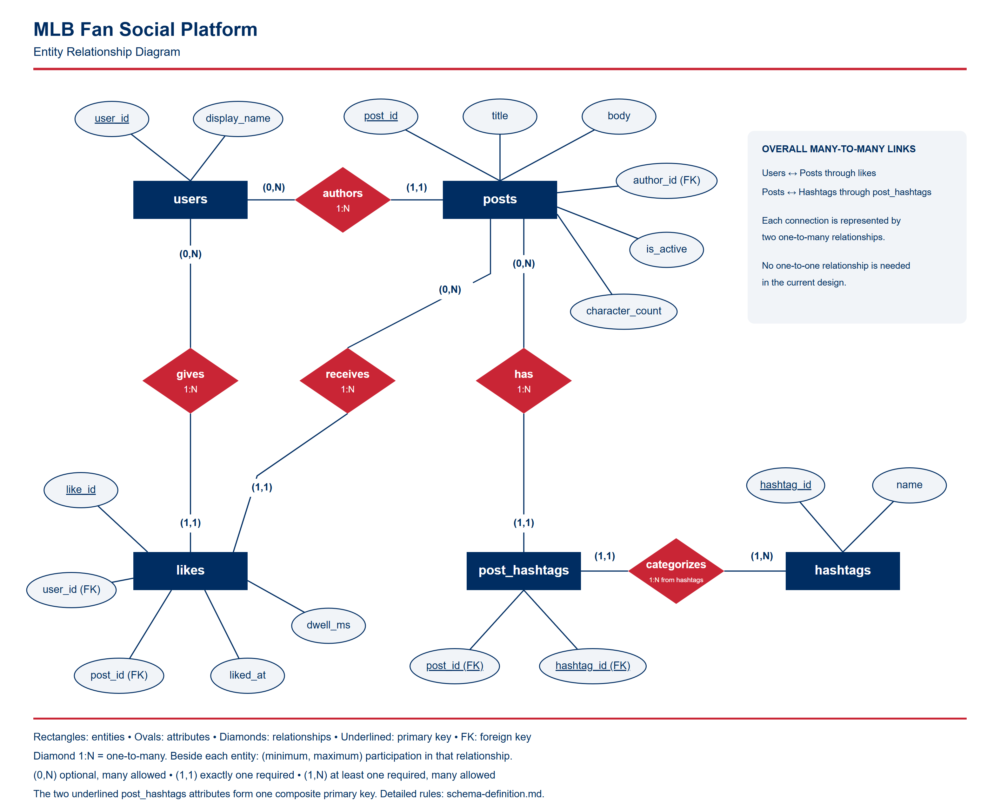

# MLB Fan Social Platform Database

A relational database design for a platform where Major League Baseball fans share short posts, give likes, and organize discussions with hashtags.

**Theme:** Social Media — Major League Baseball  
**Author:** [RainerAlvarado](https://github.com/RainerAlvarado)  
**Course:** EX603 Data and Algorithms for Scalable Systems, Boston University  
**Status:** Schema implemented in PostgreSQL; Unit 3 retrieval and filtering queries complete.

## Domain

This platform gives baseball fans a place to share reactions to games, discuss teams and players, and find posts about topics that interest them. Each registered user has a unique display name and can write posts with a title and a body of up to 280 characters. Users can like a post once and attach optional hashtags such as `#OpeningDay` or `#RedSox` to their own posts. The database models these activities through five relations: `users`, `posts`, `likes`, `hashtags`, and `post_hashtags`.

The platform needs to answer practical questions about its content and connections. Which posts did a particular user write? Which active posts use a selected hashtag? Which posts are shorter than a given character limit? Who liked a post, and which posts has a user liked? It must also identify posts with no likes or hashtags without dropping them from results simply because those connections are missing.

The interaction data will support questions such as which posts receive the most likes, how many likes occur during a selected period, and how long users view a post before liking it. Each like records its timestamp and `dwell_ms`, the viewing time in milliseconds during that visit before the like. This metric describes visits that result in likes, rather than all viewing activity. The design represents current retained content: deleting an account removes its posts and likes, and a hashtag is removed when no posts use it. Analysis of deleted activity would require a separate historical-data design.

## Entity Relationship Diagram

The diagram uses rectangles for entities, ovals for attributes, underlined primary keys, and diamonds for relationships. It shows both relationship types and minimum/maximum participation. 

Editable sources: [Mermaid model](schema/erd.mmd) · [Arranged vector diagram](schema/erd.svg).

## Schema

The full DDL is in [`schema/schema.sql`](schema/schema.sql). It targets PostgreSQL 14+, runs top to bottom on an empty database, and can be re-run safely because it starts with a reset block.

| Table | What it holds |
|---|---|
| `users` | Registered fans, each with a case-insensitively unique display name. |
| `posts` | Short posts (title plus a body of up to 280 characters) written by one user. |
| `likes` | One user liking one post, with the time of the like and `dwell_ms` viewing time. |
| `hashtags` | Topic tags such as `#OpeningDay`, unique regardless of capitalization. |
| `post_hashtags` | Junction table linking posts and hashtags (many-to-many). |

Design decisions worth noticing:

- **Surrogate identity keys** (`INTEGER GENERATED ALWAYS AS IDENTITY`) on every entity, so references stay stable when names or text change. `post_hashtags` uses a composite primary key of its two foreign keys.
- **Case-insensitive uniqueness** for display names and hashtags, enforced with unique indexes on `LOWER(...)`, because a plain `UNIQUE` is case-sensitive.
- **`character_count` is a generated column** computed from `body`, so it can never drift out of sync with the text.
- **All foreign keys use `ON DELETE CASCADE`**: deleting an account removes its posts and likes, and deleting a post removes its likes and hashtag links.
- **Hashtag lifecycle triggers**: a hashtag must be attached to at least one post when its transaction commits, and it is removed automatically once no posts use it.

Constraint reasoning, including each `ON DELETE` choice and every `CHECK`, is in [`analysis/unit2.md`](analysis/unit2.md).

## Queries

### Unit 3: Interrogating the Data

Unit 3 audits a dashboard figure that claimed about half of all reactions end in a spam removal. The queries are in [`queries/unit3/`](queries/unit3/), and the plain-language finding is in [`analysis/unit3-finding.md`](analysis/unit3-finding.md).

These queries run against the **course-provided Social Media dataset** (`social.sql`, loaded into a database named `ex603_data`), not the schema in `schema/schema.sql`. The provided dataset uses the same five roles but has its own columns, such as `likes.reaction_status`, `likes.removal_reason`, and `posts.like_count`.

| File | What it does |
|---|---|
| [`q3_1.sql`](queries/unit3/q3_1.sql) | Explores the data: visible, well-liked posts; reaction statuses and removal reasons; range and list filters; pattern matching; missing values; computed columns with `CASE`. |
| [`q3_2.sql`](queries/unit3/q3_2.sql) | Reproduces and repairs two bugs: a filter that silently drops rows with no removal reason, and a `WHERE` clause that references an alias before it exists. |
| [`q3_3.sql`](queries/unit3/q3_3.sql) | Answers one question three ways (`IN` subquery, CTE, `EXISTS`), proves the results match row for row, and shows where `NOT IN` and `NOT EXISTS` stop agreeing. |

What the audit found:

- The dataset holds 200 reactions: 156 active, 10 flagged for review, and 34 removed.
- Only 12 of the 34 removals were for spam, so the real spam-removal rate is 6 percent, not about half.
- 166 reactions have no removal reason. A "not equal to" filter on that column leaves all of them out without an error, which is how a small slice of the data came to look like the whole.
- The repaired filter accounts for every row: 188 not removed as spam plus 12 spam equals 200.

Each query has a comment header stating the requirement it answers and the question it asks. Screenshots of every query with its output are in [`screenshots/`](screenshots/), in files named `u3_*.png`.

## Design Documentation

- [Schema definition](schema/schema-definition.md) — all five relations, attributes, domains, and primary keys.
- [Integrity constraints](schema/constraints.md) — validation rules, foreign keys, deletion policies, and hashtag cleanup.
- [Modeling justification and reflection](analysis/unit1.md) — the reasoning behind the design and its tradeoffs.
- [Schema DDL](schema/schema.sql) — the PostgreSQL script that creates the full schema.
- [Implementation reasoning](analysis/unit2.md) — creation order, ON DELETE choices, CHECK constraints, and changes from Unit 1.
- [Unit 3 queries](queries/unit3/) — exploration, bug reproduction and repair, and three equivalent query forms.
- [Unit 3 finding](analysis/unit3-finding.md) — memo to the dashboard team on the spam-removal rate.
